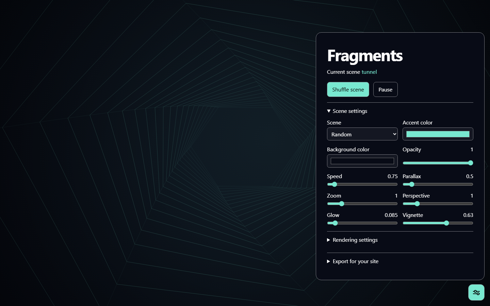

# Canvas 2D with 3D Perspective

A dependency-free browser library for animated backgrounds. It uses perspective math to project three-dimensional coordinates onto a Canvas 2D surface. The original designs come from Fragments / Glass Link.

**Current source version** · `0.1.0` ([package.json](./package.json))

## Live demo

[Open the interactive demo](https://2d3d-background.netlify.app/)

[](https://2d3d-background.netlify.app/)

Open the sliders menu in the bottom-right corner to try any of the 45 scenes and adjust the colors, motion, and perspective. When you have a scene you want to use, open **Export for your site** to copy the HTML, CSS, and JavaScript separately. The export can keep the current scene or pick a random scene on each page load.

## Technology

| Technology | Role |
| --- | --- |
| HTML and CSS | Lay out the canvas and style the demo's settings and export controls. |
| Vanilla JavaScript and Canvas 2D | Generate the scenes, calculate perspective, and draw each frame. The browser bundle has no third-party runtime dependencies. |
| Node.js | Combines the scene modules and renderer into a single browser script and prepares the static demo in `dist/`. |
| Netlify | Hosts the static demo. |

## How the rendering works

1. **Generate the scene.** Scene functions calculate points, shapes, and text from elapsed time and procedural inputs. The selected scene determines which function runs.
2. **Project depth onto the canvas.** For 3D geometry, the renderer scales each point before translating it to screen coordinates. The shared `worldPoint(x, y, z)` helper uses a scale proportional to `1 / (z + 450)`, so points farther away appear smaller. Some effects draw directly in screen coordinates.
3. **Animate and redraw.** The library uses `requestAnimationFrame` to draw successive frames with Canvas 2D. Pointer movement shifts the camera for parallax. The renderer caps pixel density and frame rate and respects the browser's reduced-motion preference by default.
4. **Apply settings live.** The demo passes edits to `background.update()`. Export generates HTML and CSS for the canvas plus JavaScript that initializes the same library with your selected settings.

## Add a background to a page

Copy [fragments-background.js](./dist/fragments-background.js) into your project. The bundle includes all 45 scenes and runs in modern browsers without npm, a CDN, WebGL, images, or bundled fonts. Keep the MIT license header when redistributing it.

This example fills a hero section. Load the script before initializing the canvas. The canvas needs explicit CSS dimensions so its layout stays stable as the script adjusts its drawing resolution.

```html
<style>
  .hero {
    position: relative;
    isolation: isolate;
    min-height: 60vh;
    background: #080b16;
    color: white;
  }
  #hero-background {
    position: absolute;
    inset: 0;
    width: 100%;
    height: 100%;
    z-index: -1;
    pointer-events: none;
  }
</style>

<section class="hero">
  <canvas id="hero-background" aria-hidden="true"></canvas>
  <h1>Your site</h1>
</section>

<script src="./fragments-background.js"></script>
<script>
  const background = FragmentsBackground.create('#hero-background', {
    scene: 'aurora',
    color: '#4de8bc',
    opacity: 0.8,
    speed: 0.6,
    parallax: 0.4
  });
</script>
```

For a full-page background, use the same layering on your page wrapper and set the canvas to `position: fixed`. Use a separate canvas and call `create` for each independently configured section.

## Configuration

Pass options to `create(canvasOrSelector, options)` or change them later with `background.update({ scene: 'grid', color: '#ad78ff' })`. Updates keep other settings. Switching scenes resets their animation time.

| Option | Default | What it changes |
| --- | --- | --- |
| `scene` | `'web'` | A built-in ID, a registered ID, or `'random'`. Random picks a scene on selection. Call `shuffle()` to pick again. |
| `color` | `'#b8c4d4'` | Accent in `#RGB` or `#RRGGBB`. Some designs also use fixed shading colors. |
| `background` | `'transparent'` | Canvas base fill. Use a concrete CSS color such as `'#080b16'` or `'rgb(8 11 22)'`. You can also set a background on the parent in CSS. |
| `opacity` | `1` | Opacity of the entire canvas, from 0 to 1. |
| `glow`, `vignette` | `0.085`, `0.63` | Strength of the shared accent glow and edge darkening, each from 0 to 1. |
| `speed`, `parallax` | `1`, `1` | Time multiplier (0–10) and pointer response (0–5). Set both to 0 for a static canvas. |
| `zoom`, `perspective` | `1`, `1` | Scene scale around the center and focal scale for the projection, each from 0.1 to 5. Effects that draw directly in screen coordinates may only respond to zoom. |
| `text`, `font` | `'FRAGMENTS'`, `'monospace'` | Text and CSS font family list for text scenes. Set `text: '01'` for binary data rain. Load any web font in your host page. |
| `rainSpeed` | `1` | Extra fall-speed multiplier for `data`, from 0.01 to 10. |
| `maxDpr`, `maxPixels` | `1.5`, `3500000` | Limits for render resolution. Lower them to reduce canvas rendering cost. |
| `maxFps` | `60` | Target frame-rate cap, from 1 to 120. |
| `respectReducedMotion` | `true` | Uses a static frame when the browser reports a reduced-motion preference. |
| `params` | `null` | Settings passed to your own scene callback. Replace the object with `update({ params: ... })` when changing it. |

Use `FragmentsBackground.scenes` to populate scene pickers and `FragmentsBackground.defaults` to inspect defaults. Read `background.scene` for the actual scene ID. Call `pause()` and `resume()` to control playback. Call `destroy()` when removing the component to cancel animation, detach listeners, and clear the canvas.

### Built-in scene IDs

- Depth and geometry: `web`, `tunnel`, `constellation`, `monoliths`, `crystals`, `city`, `dna`, `satellites`, `portals`, `grid`, `gears`, `torus`, `sonar`, `tessellation`
- Nature and space: `rain`, `forest`, `stars`, `aurora`, `ocean`, `embers`, `snow`, `blackhole`, `jellyfish`, `lightning`, `dunes`, `bamboo`, `fireflies`, `ribbons`, `bubbles`, `meteors`, `galaxy`, `lava`, `islands`, `leaves`, `mushrooms`, `firestorm`, `mountains`, `ripples`, `kites`
- Typography: `data`, `nameorbit`, `namewarp`, `typesphere`, `floatingwords`, `wordhelix`

## Add and share a design

Keep reusable scene callbacks in their own JS file. Register the callback on each background instance that uses it, then select it. Registered designs also participate in random selection.

```js
function orbitDots({ ctx, time, color, params, project }) {
  const { count = 48, radius = 380, tilt = 0.4 } = params ?? {};
  ctx.fillStyle = color;
  for (let index = 0; index < count; index++) {
    const angle = (index / count) * Math.PI * 2 + time * 0.25;
    const [x, y, scale] = project(
      Math.cos(angle) * radius,
      Math.sin(angle) * radius * tilt,
      650 + Math.sin(angle) * radius * 0.6
    );
    ctx.globalAlpha = Math.min(1, 0.5 * scale);
    ctx.beginPath();
    ctx.arc(x, y, 3 * scale, 0, Math.PI * 2);
    ctx.fill();
  }
}

background.register('orbit-dots', orbitDots);
background.update({
  scene: 'orbit-dots',
  color: '#ffa759',
  params: { count: 64, radius: 320, tilt: 0.5 }
});
```

The callback receives the Canvas 2D context in CSS pixel coordinates, `width`, `height`, elapsed animation `time` in seconds, normalized hex `color`, `text`, `font`, `params`, and the current `camera` offset. The `project(x, y, z)` helper returns screen `[x, y, scale]`. Use positive z for receding objects. Use `seeded(number)` for stable procedural variation. Balance any calls to `ctx.save()` and `ctx.restore()` inside the renderer and let the library drive the animation loop.

## Contribute a built-in scene

To add a built-in design, add a renderer and register its ID in the appropriate worlds file. Regenerate the bundle and add the ID to the README.

The scene art lives in `src/atmosphere.js` and `src/worlds*.js`. The standalone browser API lives in `src/background-standalone.template.js`. After a source change, run `node scripts/build-background.cjs` from the repo root to regenerate `dist/fragments-background.js`. Node.js is only needed to regenerate the bundle.

## Release and consume

The build reads the version from [package.json](./package.json) and includes it in the generated JavaScript header. If you consume the bundle before a release is tagged, pin it to a specific upstream commit and record that commit in your project.

Tag releases in GitHub and attach the generated browser bundle as a release asset. In a consuming project such as Digital Footprint, download the bundle from a specific release, keep its license header, and reference the local copy with a script tag. Record the upstream repo URL and release tag with the vendored file so future updates can be reviewed and reproduced.

## License

MIT. See [LICENSE](./LICENSE).
